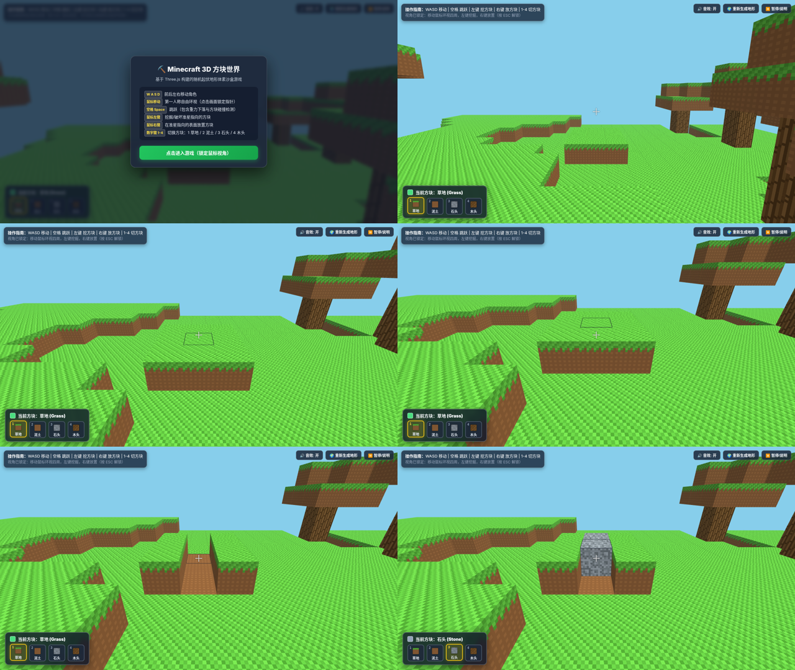
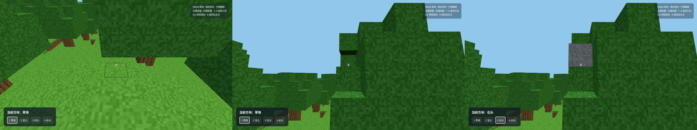

# AI Minecraft 对决：Gemini 4 Argon vs GPT-6.1-sol

同一句提示词，让两个模型各写一个单文件、浏览器直接运行的 Minecraft 风格 3D 方块游戏，然后从**体验**和**架构**两个角度评测。

作者：[@RandyJinAI](https://x.com/RandyJinAI)。

## 在线试玩

- [Gemini 4 Argon 版](https://randy-jin.github.io/ai-minecraft-battle/gemini-4-argon.html)
- [GPT-6.1-sol 版](https://randy-jin.github.io/ai-minecraft-battle/gpt-6.1-sol.html)

也可以下载 HTML 文件后双击用浏览器打开（需联网加载 Three.js）。操作：点击画面锁定鼠标，WASD 移动，空格跳跃，左键挖方块，右键放方块，数字键 1-4 切换方块。

提示词原文见 [prompt.md](prompt.md)。两份代码均为模型原样输出，未做修改。

## 结论

**Gemini 4 Argon 体验更好，GPT-6.1-sol 架构更好。** 两份都能直接玩，题目要求全部做到。

| 评分（满分 10） | Gemini 4 Argon | GPT-6.1-sol |
|---|---|---|
| 需求完成度 | 9.5 | 9 |
| 体验 | 9 | 7 |
| 架构 | 6 | 8 |

## Gemini 4 Argon

**亮点**
- 音效、挖方块粒子、像素图标快捷栏、触屏按钮、暂停和重新生成地形
- 指针锁定失败时可按住鼠标拖动转视角，兼容性好
- 分 8 个编号章节，中文注释详细，适合学习

**问题**
- 每个方块一个独立 Mesh，约 5000 多个，绘制调用多，地图放大会卡
- 每帧遍历全部方块来做瞄准检测，开销随方块数线性增长
- 有一处注释写着"防止挖穿掉进虚空"，但代码里没有实现
- 树冠用草方块代替树叶；Three.js 版本较旧（r128）

## GPT-6.1-sol

**亮点**
- 只渲染至少一面外露的方块，按类型合批为 InstancedMesh，约 5 次绘制调用
- 地图 56×56，是 Argon 版（29×29）的 3 倍多
- 碰撞用小步推进加二分修正，物理按固定子步更新，基本不会穿墙
- 数据（一个 Map）与渲染分离，结构干净

**问题**
- 每挖或放一个方块，都把整个世界重建一遍，地图越大越卡
- 瞄准检测对 InstancedMesh 逐实例计算，实测帧率约为 Argon 版的三分之一（软件渲染环境，仅供相对比较）
- 指针锁定前所有按键无响应，在不允许锁定的环境里无法游玩

## 两份都没做到的三件事

体素游戏的标准优化，也是"能跑"和"能上线"的区别：

1. **按区块（chunk）合并几何体**：修改一个方块只重建所在区块
2. **隐藏面剔除**：被相邻方块挡住的面不生成
3. **体素网格射线遍历（DDA）**：瞄准检测只走几格，开销与世界大小无关

## 截图

| Gemini 4 Argon | GPT-6.1-sol |
|---|---|
|  |  |
